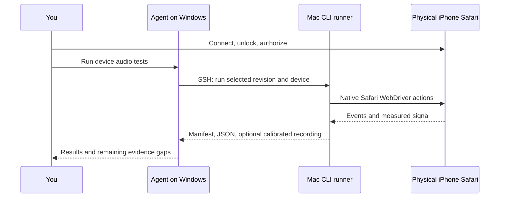

# Mobile audio fades: evidence, diagnosis, and device testing

Research date: 2026-11-01. This is an investigation and a proposed resolution plan, not a declaration that the physical-device bug is fixed. The implementation examined is the browser audio adapter and playback coordinator on `main` after PR #52. Device/browser versions and the user's failing device have not yet been established. No physical device was connected or exercised during this research.

**Your setup:** iPhone/iPad, with a Mac available. The recommended path is USB to the Mac, native Safari WebDriver, and explicit test runs initiated by an agent over SSH. Start with graph measurements and the original switching scenario; add calibrated device-output recording separately. The Windows-only and Android options below are alternatives, not prerequisites for your setup.

## What we know

The original report was a hard cutoff when switching Environments on mobile, with desktop fades working. [Issue #51](https://github.com/bencodrington/turbobard/issues/51) asks for start, stop, and transition fades while preserving autoplay, shared Sounds, rapid switches, and volume updates. [PR #52](https://github.com/bencodrington/turbobard/pull/52) added a gain fallback and explicitly disclosed that its browser tests used fake audio APIs and that physical iPhone audio was unverified.

Apple's archived guide says JavaScript cannot set media-element volume on iOS and that reads return 1. This explains why ignoring volume writes is a useful simulated failure. It does not identify the behavior of every current Safari release, every output route, or the device that exhibited this bug. Other content in that same archive describes much older iOS behavior, so use it as historical context rather than a current compatibility matrix. [Apple's archived iOS media considerations](https://developer.apple.com/library/archive/documentation/AudioVideo/Conceptual/Using_HTML5_Audio_Video/Device-SpecificConsiderations/Device-SpecificConsiderations.html).

There is a particularly relevant modern implementation detail: current WebKit's `HTMLMediaElement::setVolume` has a volume-locked branch which assigns the requested value temporarily, then queues a task that restores the old value. **Inference:** a synchronous write/read probe can return success even when per-element volume is locked. This is a source-supported hypothesis, not proof that this exact code ships in the user's Safari version. The relevant source is `setVolume`, lines 4942–4997 in the pinned revision, especially `m_volumeRevertTaskCancellationGroup`. [WebKit source](https://github.com/WebKit/WebKit/blob/e5c294264891a8932ffc6a51db197863c09d910d/Source/WebCore/html/HTMLMediaElement.cpp#L4942-L4997), consulted 2026-11-01; pinned development revision `e5c294264891a8932ffc6a51db197863c09d910d`; this is not a Safari release tag.

In plain terms, the app asks, “Did setting volume to zero work?” It immediately sees zero and decides to keep using element volume. If the browser later restores the old volume, that answer was misleading: the app never selects its gain fallback, and the later pause can sound like a hard cut. The old mock always returned 1, so it exercised a different capability-detection outcome. The first device experiment should distinguish those two behaviors.

## How the existing implementation works

The application separates Environment decisions from browser audio, as required by [ADR-0003](adr/0003-domain-and-adapter-boundaries.md).

```text
Environment Play / Stop / switch
  → playback coordinator
      → AudioPort.load / playLoop / stop / unload
          → browser adapter
              volume probe succeeds → HTMLAudioElement.volume
              volume probe fails    → media element → GainNode → destination
```

Source: [coordinator](../src/domain/coordinator.ts), [AudioPort](../src/domain/ports.ts), and [browser adapter](../src/audio/browser.ts).

The adapter currently tests an unattached audio element by setting its volume to zero and immediately reading it. On the fallback path it creates one shared `AudioContext` per adapter and one gain node per media element. It sets `crossOrigin = 'anonymous'` before `src`, connects the graph, attempts to resume a suspended context during playback, and updates gain from `requestAnimationFrame` callbacks. Stop independently schedules `pause()` after the fade duration. The coordinator also schedules unload after that same duration. These are observations of repository code, not claims about measured hardware behavior.

Three boundaries need separate evidence:

| Evidence                                         | What it can establish                                                                              | What it cannot establish                                                          |
| ------------------------------------------------ | -------------------------------------------------------------------------------------------------- | --------------------------------------------------------------------------------- |
| Deterministic unit/integration tests with fakes  | The adapter/coordinator requests the right ramp, ordering, cancellation, and cleanup               | Browser policies, decoding, audio routing, sound leaving the device               |
| Real browser API tests with generated audio      | Audio samples change through an actual browser gain graph; media loading and CORS can be exercised | That desktop WebKit behaves exactly like Safari on a physical iPhone              |
| Real device tests                                | Device-specific routing, clocks, media policies, and lifecycle behavior                            | Audibility solely from a successful promise or recorded gain value                |
| Post-gain sample measurement                     | The browser graph contains the expected amplitude envelope                                         | Speaker/Bluetooth volume, mute state, or everything downstream of the measurement |
| Calibrated device-output recording and listening | The tested output route actually produces the expected fade                                        | Other routes or device/OS versions which were not exercised                       |

Mobile emulation changes parameters such as viewport, user agent, screen, and touch support; it is useful for responsive workflows but does not turn a desktop browser into the mobile hardware stack. [Playwright emulation](https://playwright.dev/docs/emulation).

## Testing improved in this change

The old mobile browser test has been replaced by [app workflow tests](../tests/e2e/audio-fades.spec.ts) and a [real browser audio integration test](../tests/e2e/browser-audio.spec.ts). Application audio behavior has not been changed.

- **App commands:** controlled time, fresh events for each action, source-specific rising/falling ramps, a two-second duration contract, no early pause, distinct Rain→Wind crossfade, and rapid Rain→Wind→Rain restart without a stale pause/unload. These use simulated ignored-volume APIs, explicitly named as such.
- **Real graph:** the production adapter is bundled into a browser harness, a constant-amplitude WAV is generated in memory, and a cross-origin fixture is delivered with valid CORS headers. Native media decoding, context, source and gain nodes remain real. An analyser measures decoded sample amplitude after gain; the test checks non-silence, fade-in, half-volume calibration, fade-out and pause timing. Only the probe is forced to select the gain path; this does not verify real iOS capability detection, actual catalog headers, OS output, or the speakers.
- **Sensitivity:** removing fade-out made both the simulated Stop test and real graph test fail. Replacing fade-out with instant mute also made both fail. The source diff was checked for each mutation and the production adapter restored afterward. These experiments establish test sensitivity to those regressions; they do not reproduce the reported physical-phone failure.

Local validation on Node 26.12.1: `npm run verify:static` passed (114 unit tests plus formatting, lint, typecheck and build). The focused audio and existing smoke matrix passed **50 tests, with 2 explicit skips** across Chromium, Firefox, WebKit and the two mobile profiles. The skips are real graph tests on this Windows WebKit build, which exposes neither `AudioContext` nor `webkitAudioContext`; simulated WebKit app tests ran. Linux/macOS WebKit signal coverage still needs execution. Raw mutation/final-run logs are ignored under `docs/evidence/audio-audit/`; graph samples are Playwright JSON attachments. No generated evidence is committed.

Run the focused suite after selecting the `.nvmrc` runtime:

```powershell
npm run build
npm run test:e2e:audio
```

## Ranked hypotheses and decisive experiments

These are candidates to test, not a diagnosis. Start with foreground playback and the exact failing build/device. Do not simultaneously replace the engine, change buffering, and alter lifecycle logic: that would lose the ability to identify the cause.

| Priority | Hypothesis                                                                                     | Falsifiable prediction and experiment                                                                                                                                                                                                                                                                                |
| -------- | ---------------------------------------------------------------------------------------------- | -------------------------------------------------------------------------------------------------------------------------------------------------------------------------------------------------------------------------------------------------------------------------------------------------------------------- |
| 1        | The synchronous capability probe chooses element volume even though effective volume is locked | On the device, record the requested value, immediate readback, next-task readback, and measured output amplitude for a steady tone. If immediate readback succeeds but later reverts or amplitude stays constant, the probe is inadequate. Compare a test-only forced gain path using the same source.               |
| 2        | Frame callbacks stop or arrive too late while independent pause/unload timers expire           | Record monotonic timestamps for fade samples, visibility, stop, pause, and unload. If the outgoing signal stays loud until pause and there are missing ramp callbacks, compare an audio-clock-scheduled gain ramp under the same conditions. First reproduce foreground; only then add background/lock-screen cases. |
| 3        | The incoming fade runs while media is still loading, or the context has not actually resumed   | Log `play()` settlement, `playing`, `waiting`, `readyState`, media time, context state, and context time. If the two-second ramp finishes before audible playback starts, repeat with an already-loaded local tone and compare. If context time stalls, changing gain cannot make the graph render.                  |
| 4        | Web Audio routing fails or the real asset is not usable through CORS                           | Compare a same-origin fixture with the actual catalog URL, preserving redirects and headers. Collect exceptions from graph construction, media errors, and response headers. If the fixture works and the real asset is silent, investigate the fetch/route instead of fade interpolation.                           |
| 5        | Environment lifecycle, reuse, or rapid restart resets or cuts the outgoing source              | Switch between distinct Sounds, then shared Sounds, then switch back during the fade. Correlate stable element/source IDs with gain, pause, and unload events. If a restarted element is paused by an old timer, or a shared Sound is reset to zero, the coordinator/adapter lifecycle needs correction.             |

The first candidate has direct support from the WebKit source described above. The remaining candidates are grounded in code paths that can be observed independently. Chrome documents that background pages do not receive animation-frame callbacks; its policy is not proof of iOS behavior, but is enough to make frame-driven audio scheduling an explicit risk. [Chrome background scheduling](https://developer.chrome.com/blog/background_tabs).

Real audio contexts can also be interrupted or stop progressing despite misleading state. WebKit's tracker contains device-specific reports of interrupted contexts and foreground recovery failures. Those reports justify recovery tests; they do not establish the cause of this repository's bug or that every report still affects current releases. [WebKit bug 273511](https://bugs.webkit.org/show_bug.cgi?id=273511), [WebKit bug 263627](https://bugs.webkit.org/show_bug.cgi?id=263627).

The current adapter catches graph-creation exceptions and falls back to element volume without surfacing the exception. That can hide loss of fade control on the very devices needing the fallback. It only calls `resume()` for `state === 'suspended'`. Neither a successful call nor a `running` label alone measures output. These are reasons to collect focused diagnostics before choosing a fix. Source: [browser adapter](../src/audio/browser.ts).

## Possible solutions

| Option                                                                       | Benefit                                                                                      | Cost and remaining uncertainty                                                                                                                                                                                     |
| ---------------------------------------------------------------------------- | -------------------------------------------------------------------------------------------- | ------------------------------------------------------------------------------------------------------------------------------------------------------------------------------------------------------------------ |
| Repair capability selection and expose audio-path failures                   | Smallest targeted change if a false-positive probe is confirmed; can retain desktop behavior | A delayed readback still measures an API property, not effective acoustic volume. Any fallback should be verified on the target device. Avoid user-agent sniffing as the sole evidence.                            |
| Use a shared Web Audio gain path and schedule ramps on the audio clock       | A consistent place for volume and fading; avoids depending on frame-by-frame JS updates      | Expands CORS, autoplay, interruption, and output-route responsibilities to more browsers. Audio-clock automation does not prevent OS suspension. Requires cleanup and interruption tests.                          |
| Keep streaming media for long Loops, use decoded buffers for short One-shots | Precise short-effect scheduling while retaining streamed long assets                         | Two source types still need one volume/lifecycle contract, buffering policy, error handling, and device checks.                                                                                                    |
| Move all playback to decoded buffers or a mature audio library               | Could centralize scheduling and compatibility work                                           | Larger redesign; decoded long assets use memory, change startup/loading behavior, and can conflict with deferred mobile loading goals. A library still uses browser policies and needs the same real-device tests. |

The Web Audio standard provides audio-time scheduling through `AudioParam`, including linear ramps and cancellation that holds the current value. It also requires media-element sources to produce silence for resources which are CORS-cross-origin. These contracts motivate an explicit audio graph and real-asset checks; they do not promise that a context will remain active in every mobile lifecycle state. [Web Audio Recommendation: AudioParam](https://www.w3.org/TR/2021/REC-webaudio-20210617/#AudioParam), [media-element source security](https://www.w3.org/TR/2021/REC-webaudio-20210617/#MediaElementAudioSourceNode-security).

If audio-clock ramps are chosen, cancellation must preserve the audible level when Stop, restart, or volume changes interrupt a ramp. Pause/unload must not cut the source before the ramp completes. Decide explicitly whether an Environment switch should preserve a shared Sound continuously or restart it; test that product contract rather than accepting a zero reset accidentally. This is a proposed design constraint derived from the existing code and acceptance criteria.

Keep autoplay verification separate from gain interpolation. Real tests should initiate playback through a browser-generated click/tap and record rejection details, rather than using `page.evaluate(() => button.click())` or disabling autoplay policy. Chromium recommends resuming Web Audio after user activation and checking playback promises. [Chromium autoplay guidance](https://www.chromium.org/audio-video/autoplay/).

## A systematic path to a confirmed fix

1. **Identify the failing case.** Record phone model, OS/browser versions, tab versus installed home-screen app, exact build SHA/build ID, output route, hardware volume, foreground/background status, and two Environments involved. Keep the original report's sequence as the acceptance scenario.
2. **Calibrate measurement.** Use a generated constant-amplitude tone with an audible plateau. Show that the measurement distinguishes full level, half level, and silence. For transition tests use two distinguishable frequencies or independently measured graph branches. A rain recording's changing loudness is a poor reference signal.
3. **Establish a red device loop.** Repeat the original sequence on the failing build and save timestamps plus sample amplitude or an output recording. Define a pass/fail envelope and duration tolerance before changing the implementation. If it cannot reproduce, record the attempted combinations and obtain the missing device/build information; do not label a guessed cause confirmed.
4. **Test the ranked candidates.** Start with property-readback timing and effective amplitude, then frame timing, readiness/context progression, CORS, and lifecycle. Change one variable at a time. Keep diagnostic code scoped to the test harness/build and redact credentials and signed query strings from artifacts.
5. **Make the smallest supported change.** Add a regression at the seam which reproduces the confirmed cause. Prove the test fails on the original behavior, passes with the change, and still fails if the essential fix is removed. Run the original device case again.
6. **Expand the matrix.** Check fade-in, stop, A→B switch, shared Sound, rapid A→B→A, mid-fade volume change, removal, One-shots, actual remote assets, cold/loaded playback, tab restore, lock/unlock, and at least the affected output route. Keep foreground acceptance distinct from background capabilities.
7. **Report the evidence precisely.** State whether a result is fake-command coverage, real graph sample coverage, physical-device graph coverage, or recorded/listened output. Attach build/device identity, raw results, and remaining gaps. A green desktop/emulation suite cannot close the physical-device acceptance item on its own.

## Connecting a physical device for future agents

All paths below use CLI/API tools and scripted browser tests. The human performs trust prompts, settings changes, unlocks, and any necessary listening checks. No Computer Use, desktop inspection, or browser inspection UI is required of the agent. These are setup instructions and design options; none of these device connections has been configured or tested in this session.

### iPhone/iPad with access to a Mac: the simplest supported Safari route

Apple's native Safari WebDriver supports a real iOS/iPadOS device connected to a Mac. On the Mac, enable Safari automation with `safaridriver --enable`. On the device, enable Web Inspector and Remote Automation under Safari's Advanced settings; the location may be under Settings → Apps → Safari on newer systems. Connect by USB, trust the Mac, and keep the device unlocked. [Apple device setup](https://developer.apple.com/documentation/safari-developer-tools/ios-enabling-webdriver), [WebKit's WebDriver setup and capabilities](https://webkit.org/blog/9395/webdriver-is-coming-to-safari-in-ios-13/).

An agent on Windows can run a checked-in test script on that Mac over SSH. The script should start a loopback-bound `safaridriver`, request `browserName: safari` and `platformName: ios`, explicitly select the device, and use Selenium/WebDriver to navigate and tap web elements. Run one session per device. Use a reachable HTTPS test URL or serve the build on the Mac/LAN; `localhost` on the phone refers to the phone, not Windows. WebDriver sessions use isolated browsing storage, so seed test data and account for private-staging authentication. Native Safari WebDriver needs no WebDriverAgent signing for these web tests; Appium is an alternative when native-device actions are required.

For your setup, use this preparation and first-run sequence:

1. **You, once on the Mac:** run `/usr/bin/safaridriver --enable` and complete its administrator authentication. Enable Remote Login for the chosen macOS account if the agent will connect from Windows; establish SSH access and a trusted host key. Confirm the Mac's installed `man safaridriver` supports your device version and device-selection capabilities. [Apple Remote Login setup](https://support.apple.com/guide/mac-help/allow-a-remote-computer-to-access-your-mac-mchlp1066/mac).
2. **You, once on the device:** enable Safari Web Inspector and Remote Automation; connect a data-capable USB cable, accept Trust This Computer, and unlock the device. These native Safari web tests do not require Appium/WDA provisioning. Leave the Mac awake and phone available during a run.
3. **Agent setup on the Mac:** check out the exact build/test revision, select Node from `.nvmrc`, install dependencies, and add a WebDriver runner or a driver-neutral diagnostic page. The new desktop Playwright specs are useful reference assertions but cannot simply be pointed at native Safari; Playwright does not directly control branded Safari. [Playwright browser support](https://playwright.dev/docs/browsers#webkit).
4. **First pilot:** start `/usr/bin/safaridriver --port 4444`, create an explicitly selected real-iOS session, open a phone-reachable test URL, click Play through WebDriver, and collect a JSON result. Record the returned session capabilities to prove the selected phone/OS and reject simulator or desktop sessions. Stop the session and driver after the run. Verify device-selection keys against the installed driver's manual before implementing the runner.
5. **Normal future use:** you connect/unlock the phone and ask the agent to run device audio tests. The agent invokes the Mac runner over SSH and retrieves the manifest, events, measurements and result files. A missing phone, locked device, failed session or wrong build must fail explicitly. Nothing needs to run on a schedule or remain permanently connected.



The Mac runner and device diagnostic page are **not implemented by this testing change**. Its first device case should use the adapter's natural capability decision, without replacing `Audio`, `AudioContext` or volume behavior. A separately labelled forced-gain comparison can test the leading hypothesis. Keep original browser/profile behavior in a manual-tab comparison because an isolated automation session can differ from normal use, and use separate manual/device tooling for lock-screen and interruption scenarios suppressed by Safari WebDriver.

For **actual output recording**, Appium documents redirecting a USB-connected iPhone's application audio to a Mac using Audio MIDI Setup, then recording the selected AVFoundation input with `ffmpeg`. The human must enable the device input and grant relevant recording permissions first. Agents can subsequently enumerate capture inputs and record through CLI. Appium's own recording commands additionally require the server's `audio_record` feature to be enabled. This changes the route being tested and needs a calibration recording; it does not prove the built-in speaker/Bluetooth route behaves identically. [Appium audio capture](https://appium.github.io/appium-xcuitest-driver/12.16/guides/audio-capture/).

### iPhone/iPad with Windows only

There are three practical choices:

- **Lowest setup burden: a user-started diagnostic webpage.** Build a small test page served over reachable HTTPS, open it on the actual phone, and tap Start. It can run real API/coordinator cases and send structured results to a local collector over HTTPS for the agent to inspect. This provides real-device graph evidence without OS automation or a Mac. It is a proposed harness, not a tool already present in this repo. Keep a manual-tap variant for gesture-sensitive scenarios; programmatic transitions alone are not proof of UI gesture behavior. Speaker listening or a separate recording remains necessary for output evidence.
- **Local automation: current Appium's limited non-macOS support.** Its documented route supports real iOS 18+ devices with explicit UDID and platform version, a RemoteXPC tunnel, and preinstalled WebDriverAgent or an externally managed WDA server. Windows cannot build WDA with Xcode, so obtaining a correctly signed, provisioned WDA remains a prerequisite. This is an advanced compatibility path; validate the specific driver/device/Safari combination before relying on it. [Appium non-macOS hosts](https://appium.github.io/appium-xcuitest-driver/12.16/guides/non-macos-hosts/), [preinstalled WDA](https://appium.github.io/appium-xcuitest-driver/12.16/guides/run-preinstalled-wda/).
- **Cloud real devices:** BrowserStack currently documents Playwright tests on physical iOS Safari devices. This avoids maintaining a local Mac but requires an account, appropriate access, credentials, and a reachable test build/tunnel. It tests the provider's phones, not your phone. Validate API support and audio capture explicitly; an advertised session video does not establish audio-output recording. No service purchase or connection is proposed as an automatic action here. [BrowserStack real-iOS Playwright](https://www.browserstack.com/docs/automate/playwright/playwright-ios/nodejs).

The Appium Windows path also needs Apple Mobile Device drivers and an authenticated/trusted device; the RemoteXPC service must remain available during tests. Its documentation describes privileged tunnel setup, so have a human provision that part, then use the resulting local API for test runs. Check the installed driver with `appium driver doctor xcuitest` rather than assuming the example documentation matches the installed version. [Appium RemoteXPC prerequisites](https://appium.github.io/appium-xcuitest-driver/12.16/guides/remotexpc-tunnels-real-devices/).

For Appium/WDA, the device preparation guide also requires Developer Mode on iOS/iPadOS 16+, UI Automation, Safari Web Inspector/Remote Automation for web testing, and a valid WDA provisioning profile. These are human setup steps; do not confuse them with the lighter native Safari WebDriver path described above. [Appium device preparation](https://appium.github.io/appium-xcuitest-driver/12.16/getting-started/device-setup/).

### Android with Windows: USB + ADB + Playwright

Install Android SDK Platform Tools, enable Developer options and USB debugging on the phone, connect USB, and manually accept the RSA trust prompt. The Windows USB driver may be required. `adb devices -l` must show the selected device as authorized, not `offline` or `unauthorized`. [Android ADB setup](https://developer.android.com/tools/adb), [Chrome Android connection troubleshooting](https://developer.chrome.com/docs/devtools/remote-debugging).

Playwright's experimental Android API can enumerate devices and launch Chrome on the real phone. Current documentation requires Chrome 105+ and the relevant command-line flag setting; it warns that not all Playwright features work on-device. Pin compatible versions and validate the required APIs. Keep the device awake. [Playwright Android](https://playwright.dev/docs/api/class-android).

For the local app, ADB reverse maps a device-local port to the host's server. A setup/test script can use the selected serial:

```powershell
adb devices -l
adb -s <serial> reverse tcp:4173 tcp:4173
```

Start the verified app build's preview server on the host port, then navigate the phone browser to `http://127.0.0.1:4173`. Confirm `window.isSecureContext` before adding secure-context-dependent measurements. Select a single device explicitly; do not silently choose the first attached phone. ADB documents reverse forwarding in its CLI reference; use `adb reverse --help` for the installed version. [ADB command manual](https://android.googlesource.com/platform/packages/modules/adb/+/refs/heads/main/docs/user/adb.1.md).

An alternative is an existing Chrome session: forward the device's Chrome debug socket and attach with Playwright's `chromium.connectOverCDP`. Google documents the forwarding command; Playwright warns that CDP attachment has lower fidelity than its own protocol and only supports Chromium. It is not a route to iPhone Safari. [Chrome CDP forwarding](https://developer.chrome.com/docs/devtools/remote-debugging), [Playwright CDP attachment](https://playwright.dev/docs/api/class-browsertype#browser-type-connect-over-cdp).

### Make tests intentionally runnable, not permanently active

After choosing and validating a connection, add an explicit repository command such as `npm run test:device:audio` with configuration for target URL and device identifier. This command is **a proposed future interface**, not currently installed. Leave it out of routine CI and run it only when the user requests a device session. A disconnected, locked, unauthorized, or wrong device should produce a clear setup failure, never a silent pass or fallback to emulation.

Each run should save an ignored `docs/evidence/device-audio/<run-id>/` directory containing:

- `manifest.json`: source/build identity, device/browser/OS, driver versions, source type, output route, start time, and whether fakes or policy overrides were used.
- `events.json`: requested gain/volume, immediate and deferred readback, actual media time, context state/time, visibility, play settlement, pause/unload, and action IDs.
- `measurements.json`: post-gain amplitude windows and independently chosen thresholds, with separate results for outgoing and incoming Sounds.
- Device-output audio when a calibrated recording path exists; otherwise an explicit `outputAudioVerified: false` and a place for the user's listening result.
- Test result/trace and a short explanation of what the run establishes and what remains untested.

Preserve the original real-browser policies. A specialized launch helper may alter autoplay permissions or profile settings, so first record its behavior and compare a normal manually opened tab. Do not treat a successful automated session as proof of normal-user autoplay without that comparison. Keep local debugging endpoints on loopback and use SSH forwarding when needed. Store access keys in environment variables and omit them from saved command lines, traces, and reports.

The immediate recommendation is to obtain the failing device/build identity, establish an instrumented real-device repro, and test the synchronous probe first. If a Mac is available, native Safari WebDriver plus calibrated audio capture is the clearest long-term iPhone setup. With Windows alone, a user-started diagnostic page is the quickest way to collect meaningful evidence from the user's actual iPhone while evaluating the more involved Appium route.
